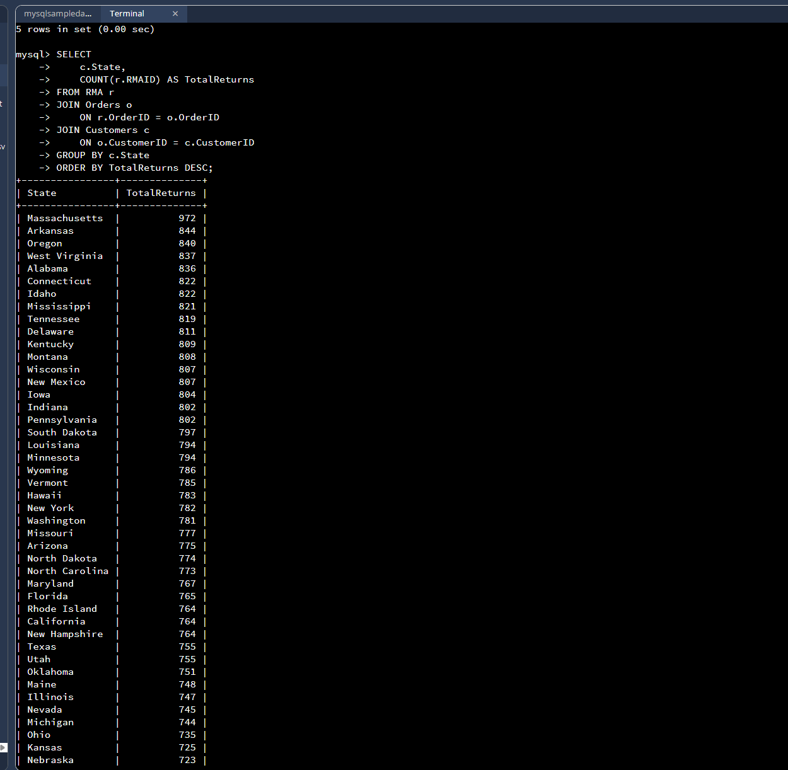
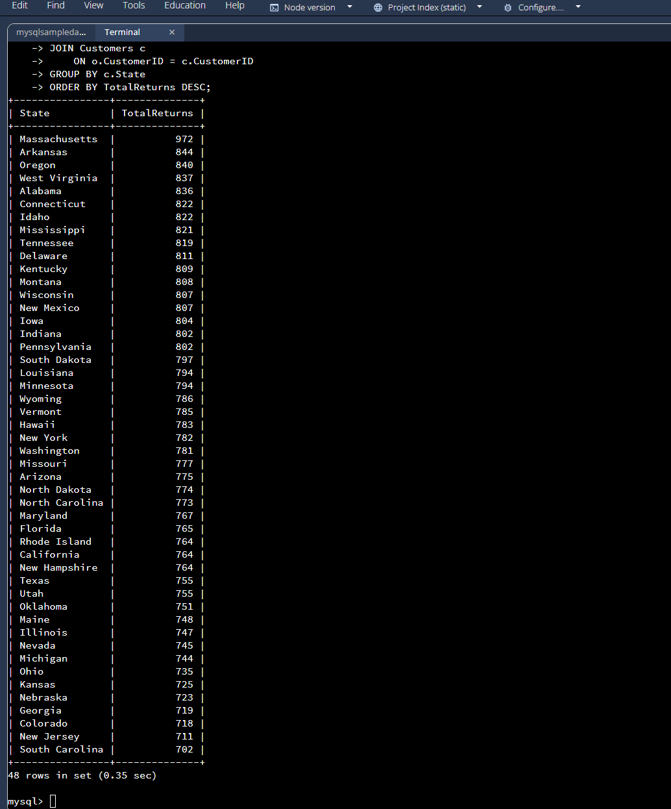
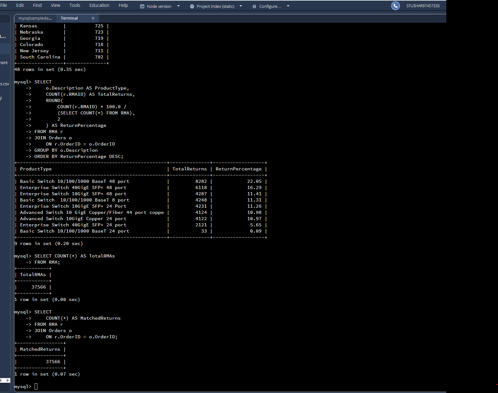
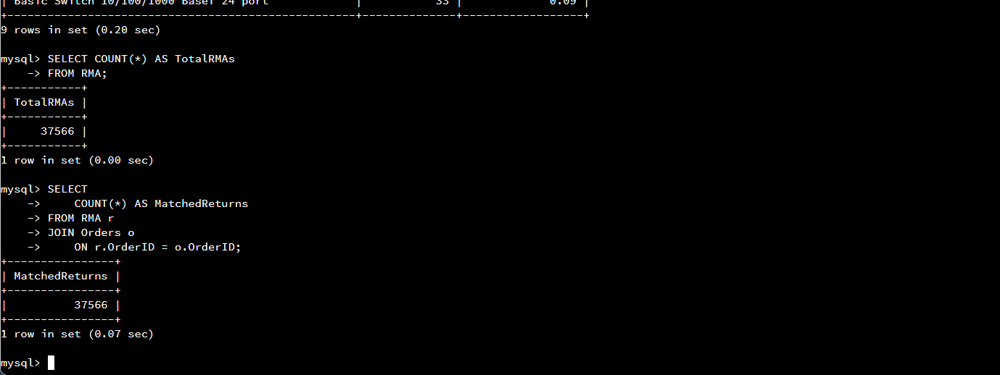

# Project Two — Quantigration RMA Data Analysis

This folder documents a SQL analysis conducted in the **DAD 220 Codio lab environment** for an educational scenario involving a fictional networking-equipment company, Quantigration.

**Important data distinction:** The findings below were observed in the **larger course-lab database**, not in the separate, much smaller **synthetic demonstration dataset** included elsewhere in this public repository. Running these SQL queries against that demo dataset will **not** reproduce the counts below. No original class-provided CSV datasets are included here.

## Questions examined

1. How many return merchandise authorizations (RMAs) are associated with customers in each state?
2. What **share of all RMA records** belongs to each product description?
3. Do RMA records link successfully to orders?

## Lab findings

| Measure | Observed result |
| --- | ---: |
| Total RMA rows | 37,566 |
| RMA rows matching an order | 37,566 |
| State values in state-based query | 48 |
| Product descriptions in analysis | 9 |
| Highest state count: Massachusetts | 972 |
| Second state count: Arkansas | 844 |
| Third state count: Oregon | 840 |
| Lowest state count: South Carolina | 702 |
| Highest product share: Basic Switch 10/100/1000 BaseT 48 port | 8,282 (22.05%) |
| Second product share: Enterprise Switch 40GigE SFP+ 48 port | 6,118 (16.29%) |
| Lowest product share: Basic Switch 10/100/1000 BaseT 24 port | 33 (0.09%) |

The leading two product descriptions account for **38.34%** of the RMA records in the lab dataset.

## Interpretation and limitations

- Higher state return totals may reflect a larger base of customers or orders; they do not automatically show a higher **return rate**.
- Product percentages show the **distribution of RMA records**, not the proportion of units sold that were returned. We would need the number of units sold for each product to calculate return rates.
- An RMA record is not necessarily a completed physical return; the available RMA table includes status information that could be analyzed separately.
- The join verification establishes that all 37,566 RMA records matched an order, **not** that all records are accurate, unique in business terms, or matched to customers.

**Operational next steps:** Review reasons and statuses for high-volume items; compare RMA counts against sales volume; and check return trends over time once dates are available.

## Files

- [`rma_analysis.sql`](rma_analysis.sql) — executed analysis and verification SQL.
- [`RMA_Analysis_Report.pdf`](RMA_Analysis_Report.pdf) — stakeholder-friendly findings and caveats.
- [`screenshots/returns_by_state_1.png`](screenshots/returns_by_state_1.png) — state SQL query and first results.
- [`screenshots/returns_by_state_2.png`](screenshots/returns_by_state_2.png) — remaining state results.
- [`screenshots/returns_by_product.png`](screenshots/returns_by_product.png) — product distribution SQL and results.
- [`screenshots/data_verification.png`](screenshots/data_verification.png) — RMA total and order-match checks.

### Selected evidence

**Returns by state (first portion of output)**  

**Returns by state (remaining output)**  

**Returns by product description**  

**Verification checks**  

## Tools and methods

MySQL 8.0, `JOIN`, `GROUP BY`, `COUNT`, `ROUND`, `ORDER BY`, and business-oriented data interpretation.

This is a portfolio presentation of coursework-based query evidence; it is not a production application. Screenshots have only been **cropped** to focus on query evidence and avoid displaying the lab account label; SQL text and output were not altered.
